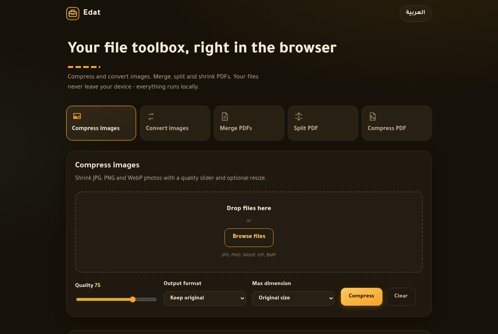
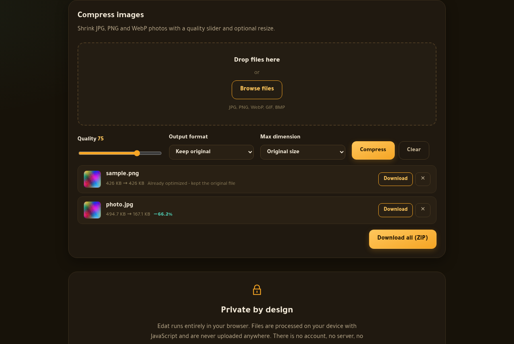
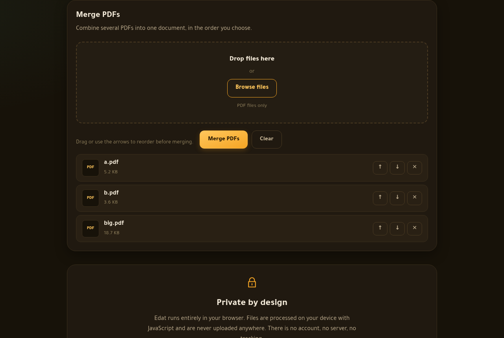

<p align="center">
  
</p>

<h1 align="center">Edat · عِدّة</h1>

<p align="center">
  <b>Your file toolbox, right in the browser.</b><br>
  Compress and convert images. Turn images into a PDF. Merge, split and shrink PDFs.<br>
  Your files never leave your device - every byte is processed locally with JavaScript.
</p>

<p align="center">
  <a href="https://yousefkhames.github.io/edat/"><b>Live demo · https://yousefkhames.github.io/edat/</b></a>
</p>

<p align="center">
  
</p>

## Why Edat

Most "free" file tools upload your documents to a server you know nothing about.
Edat does the same jobs with zero upload: open the page, drop your files, get results.
You can even disconnect from the internet after the page loads - everything still works.

- **Private by design** - no server, no account, no tracking, no upload. Files are read and written by your browser only.
- **Arabic & English** - full bilingual UI with proper right-to-left layout.
- **Mobile first** - designed for phones, comfortable on desktops.
- **Free and open source** - MIT licensed, no paywalls, no watermarks, no limits.

## Tools

| Tool | What it does |
| --- | --- |
| **Compress images** | Quality slider + optional max-dimension resize for JPG, PNG, WebP, GIF, BMP. If the result would be bigger than the original, Edat keeps your original file and tells you. |
| **Convert images** | Batch convert between PNG, JPG and WebP. |
| **Images to PDF** | Turn photos and scans into one PDF, one image per page, reordered with arrows. Pages match the image size or fit A4. Phone photo rotation (EXIF) is respected. |
| **Merge PDFs** | Combine any number of PDFs, reordered with arrows before merging. |
| **Split PDF** | Extract page ranges (`1-3, 5, 8-10`) into one PDF, a ZIP of per-range PDFs, or a ZIP of every page. |
| **Compress PDF** | Rebuilds each page as a JPEG image at your chosen quality and resolution. Makes heavy PDFs dramatically smaller. |

<p align="center">
  
</p>

## Honest limits

- **PDF compression rasterizes pages.** Text in the compressed PDF is no longer selectable or searchable, and hyperlinks are flattened. That tradeoff is how the size drops.
- **PDF compression of vector-heavy files can occasionally produce a larger file** at high resolution settings - pick "Small" for the best ratio.
- **Password-protected PDFs cannot be opened.** There is no way to unlock them client-side without the password.
- **GIFs are processed as a single (first) frame.** Animated GIFs become still images.
- **Your stats (files processed, bytes saved) live in `localStorage` of this browser only.** Clearing site data resets them.
- **GitHub Pages is a static demo host.** There is no backend by design; availability follows GitHub Pages.

## Tech

Plain HTML/CSS/JS, no build step. Libraries are vendored locally in `vendor/`
(so the app never calls a CDN at runtime):

- [pdf-lib](https://pdf-lib.js.org/) 1.17.1 - PDF merge / split / rebuild
- [PDF.js](https://mozilla.github.io/pdf.js/) 3.11.174 - page rendering for PDF compression
- [JSZip](https://stuk.github.io/jszip/) 3.10.1 - ZIP downloads
- [Tajawal](https://github.com/googlefonts/tajawal) - self-hosted Arabic/Latin typeface
- Canvas API - image compression and conversion

## Screenshots

| English | العربية |
| --- | --- |
|  |  |



## Run locally

It is a static site - open `index.html`, or serve the folder:

```bash
python3 -m http.server 8080
# open http://localhost:8080
```

## Tests

```bash
npm install        # dev-only: puppeteer-core for the browser click-through
npm test           # unit tests for the core logic (node:test)
npm run test:e2e   # real Chrome click-through of every tool against a local server
```

The E2E suite loads the app in headless Chrome and exercises each tool with real
files: compressing images, converting formats, reordering and merging PDFs,
splitting by range (including rejecting an out-of-bounds range), compressing a
PDF, switching the UI to Arabic and back, and checking the local stats counter.

## License

MIT - see [LICENSE](LICENSE).
